# SMB-ZTX

A small-business zero-trust platform, aimed at functional parity with the Zscaler Zero Trust Exchange for organisations of roughly 5 to 250 people with no security team. This repository holds the research, the specification, the design, the test plan and a first runnable build (RB1) in Go.

**RB1 is an evaluation build, not a product.** It proves the core loop: identity and device posture, then policy, then a brokered private connection or a filtered web request. It does not inspect TLS, has no DLP, no browser isolation and no installers. See [ROADMAP.md](ROADMAP.md) for everything left out, and [STATUS.md](STATUS.md) for what is done and what is broken or missing.

## Documents

| File | What it is |
|---|---|
| [USABILITY-RUNBOOK.md](USABILITY-RUNBOOK.md) | Script for the checks that need people (first-user time, alert clarity, workspace browser by hand) |
| [STATUS.md](STATUS.md) | Current progress, known gaps, open decisions. Updated after every subtask |
| [REQUIREMENTS.md](REQUIREMENTS.md) | The requirements (v0.5). Tagged `[V]` verified against a public source or `[I]` inferred |
| [DESIGN.md](DESIGN.md) | Software design for RB1 |
| [TEST-PLAN.md](TEST-PLAN.md) | Test plan for RB1 |
| [ROADMAP.md](ROADMAP.md) | Features deferred beyond RB1, including newly-Must items |
| [RESULTS.md](RESULTS.md) | Measured targets and misses |
| [RELEASE.md](RELEASE.md) | How a release is built (reproducibly, with checksums, a bill of materials and a signature) and how to check one |
| [SIEM-SCHEMA.md](SIEM-SCHEMA.md) | What log streaming sends (HTTPS and syslog) and how |
| [GAPS.md](GAPS.md) | Gaps between the requirements and the code, with the work queue |
| [COMPETITIVE-ANALYSIS.md](COMPETITIVE-ANALYSIS.md) | Cato Networks and Palo Alto Networks |
| `.doc/ZSCALER-IDEAS.md` | Low-hanging ideas for Zscaler. The source PDFs in `.doc/*/` are git-ignored |

## Layout

```
cmd/ztx-cp         control plane: admin API, enrolment, state sync, alerts
cmd/ztx-en         enforcement node: private-access broker and web proxy
cmd/ztx-connector  runs next to private apps; only dials out
cmd/ztx-agent      endpoint agent: OIDC login, posture, local SOCKS and HTTP proxies
internal/          policy, mux, pki, posture, idp, broker, webproxy, store, cp, en, agent, alerts, audit
test/idp           in-process OIDC provider for tests
test/e2e           end-to-end scenarios that start the real binaries
test/real          real-environment tests on a Linux node with Kubernetes (TEST-PLAN.md T7)
```

## Build and test

Needs Go 1.24 or newer.

```
make build     # binaries into bin/
make race      # unit and component tests with the race detector
make e2e       # end-to-end scenarios with the real binaries (about 30 s)
make fuzz      # 30 s per fuzz target
go test -tags perf -v -run TestPerf ./internal/broker   # performance targets
```

**Releases:** `VERSION=v0.2.0 RELEASE_KEY=release-key.key make release` writes `dist/` with the programs, `sbom.cdx.json`, `SHA256SUMS` and its signature; `ztx-release verify` checks one. See [RELEASE.md](RELEASE.md).

## HowTo: build in Docker and run the real-environment tests

**Build without installing Go.** All you need is Docker:

```
make docker-build            # binaries into bin/, built in a golang container (GOIMAGE=golang:<version> to change it)
```

**Run the real-environment tests** (TEST-PLAN.md section T7). They run the product's real binaries on a Linux machine
with a Kubernetes cluster: the connector as a pod, private apps as cluster services, agents as processes on the node.
You provide the machine; the requirements for it are in [test/real/README.md](test/real/README.md): ssh with a key,
passwordless sudo, `rsync`, `docker`, `kubectl` and a reachable cluster. Go is **not** needed on the node: the code
is built in a container there.

```
export ZTX_TEST_NODE=<username>@<servername>   # your machine; never committed
test/real/run.sh setup       # once: pulls the Go build image onto the node
test/real/run.sh run         # rsync, build in a container, run the REAL- tests on the node, record the result
test/real/run.sh run 'PA'    # only tests whose name matches
test/real/run.sh clean       # remove leftovers of earlier runs (by label) and nothing else
```

A run uses one namespace named `ztx-real-<run id>` and removes it at the end, also when a test fails. Results are
appended to [RESULTS-REAL.md](RESULTS-REAL.md) with the date, commit, the node's operating system and core count.
All 20 planned tests exist (TEST-PLAN.md T7.6); RESULTS-REAL.md records every run, including failed ones.

## How it fits with what you already have

The diagrams use Mermaid, which GitHub draws in the browser. "Built" means the code does it and a test covers it; "not built" and "not tested" are said where they apply. **None of this has been tried against a real Google, Microsoft or Cloudflare account or a real office network.** The sign-in is tested against a test OIDC server, and the Kubernetes run in `RESULTS-REAL.md` is a test cluster. Treat the provider-specific steps as what the standards say should work, and report what differs.

### The parts and where each one sits

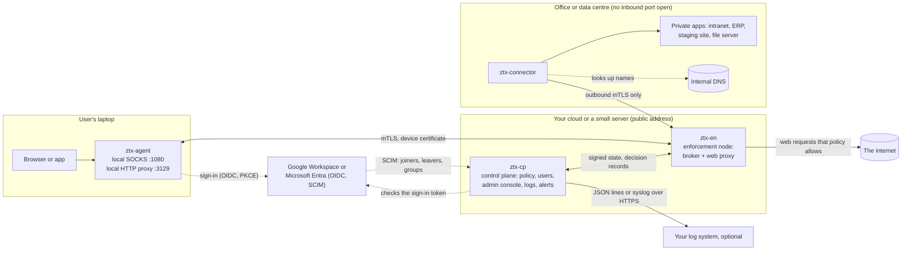

Two rules shape every example below. **The connector only dials out**, so the office firewall needs no inbound rule. **Private apps are reached by a name you give them** (for example `wiki.ztx`) through the agent's local SOCKS or HTTP proxy; the product does not capture all device traffic and does not change the device's DNS.

### Data flow 1: signing in and enrolling a device

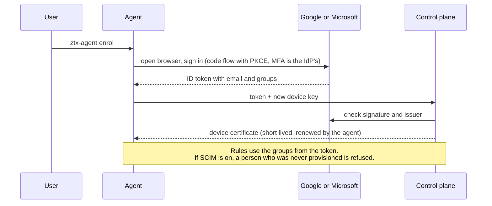

### Data flow 2: reaching a private app

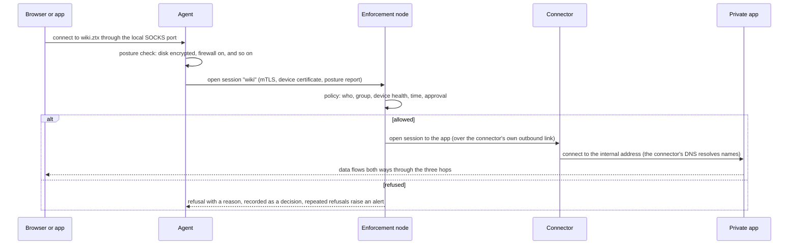

### Data flow 3: browsing the web

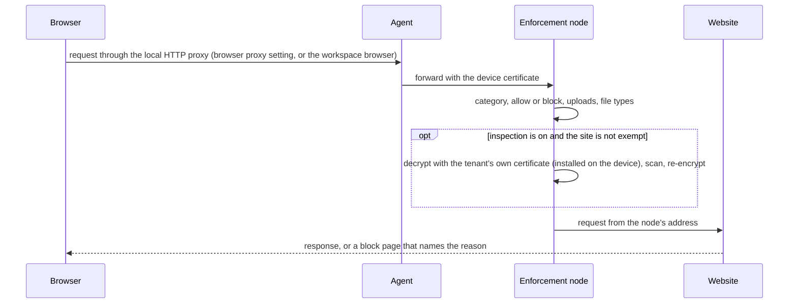

The web proxy refuses to connect to private addresses, on purpose. An internal site is therefore reached as a private app (flow 2), never through the web path.

### Example A: single sign-on with Google Workspace or Microsoft Entra ID

*Built and tested against a test OIDC server; not yet tried with a real Google or Microsoft account.*

1. Create an OAuth/OIDC client of type **public** (no secret) with the redirect URI `http://127.0.0.1/callback` (loopback, any port). Use the code flow with PKCE.
2. Tell the control plane the provider: `PUT /v1/idp {"issuer": "...", "client_id": "...", "group_claim": "groups"}`. The issuer is `https://login.microsoftonline.com/<directory-id>/v2.0` for Microsoft and `https://accounts.google.com` for Google.
3. **Groups.** Entra can put group names or ids in the `groups` claim. Google's standard ID token does not carry groups, so with Google either name people in rules (`users`) or provision groups with SCIM (step 4), and check on the first sign-in that the group you rely on is really in the token. A rule on a group the token never carries refuses everyone, which is the safe failure but confusing.
4. **Joiners and leavers.** In Entra or Google Workspace point automatic provisioning at `https://<admin address>/scim/v2` with the token from `POST /v1/scim/token`. With `require_provisioned` on, someone who is removed at the provider loses access without anyone touching this product.
5. **MFA is the provider's.** The product reads the result; it does not run a second factor of its own.

### Example B: an existing LDAP or Active Directory

*Not built. The product has no LDAP client.* Do not point it at a directory directly. Two ways that keep it working:

- **Directory in the cloud:** sync AD to Entra ID (Entra Connect) or to Google (Cloud Directory Sync), then follow Example A. Users and groups come from the cloud provider; the product never sees LDAP.
- **A small OIDC front for LDAP:** run an open-source identity provider that speaks LDAP behind and OIDC in front (Keycloak, Authentik or similar), emit a `groups` claim, and register it as the issuer in step 2 above. This adds a server to look after. It is the sensible choice only if you have no cloud directory.

Either way the first sign-in decides it: check the token shows the email and the groups you expect before writing rules.

### Example C: a small-business VPN or tunnel such as Cloudflare

*Not built, not tested.* There is no Cloudflare integration. What can be said from how the parts work:

| You have | What changes | Watch for |
|---|---|---|
| Cloudflare Tunnel (`cloudflared`) next to an internal app | `ztx-connector` plays the same role: it dials out and the office opens no port. Move one app at a time: add it as a private app, test, then retire its tunnel. | The two products have separate policies and logs; do not run both on one app and assume the stricter one wins. |
| A device VPN or WARP-style client on laptops | The agent only opens local proxy ports and talks outward to the enforcement node, so it normally runs inside whatever tunnel the device has. | A full-tunnel client that blocks the node's address stops the agent; add the node's address to that client's allow list. Test on one laptop first. |
| A site-to-site or remote-access VPN you want to remove | Put a connector in each network the VPN reached and list the apps people really use as private apps. | Everything not listed becomes unreachable: that is the point, and also where complaints come from. Keep the VPN until the list matches real use (use the decision log and the policy simulator). |

### Example D: an existing public website

*Built for access control; the public site itself is untouched.*

- **The public site stays as it is.** It is not routed through this product. Put it behind your normal web host or CDN.
- **Its admin and staging parts become private apps.** Put a connector where the web server can be reached, add a segment for `host:port` of the admin site, give it a name (`shop-admin.ztx`) in the agent's `apps` map and a rule such as "group `web-team`, healthy device". Then close the admin address to the internet. The `Apps` console screen shows in words who can reach it.
- **Staff browsing and uploading to it** go through the web path (flow 3): you can block uploads of programs, set file types, and block lookalike or risky sites.
- **Limit:** the product does not sit in front of the site as a reverse proxy or web application firewall for your customers. That is a different job.

### Example E: a small intranet with its own DNS and proxy

*Built for the intranet; no DNS service and no proxy chaining exist.*

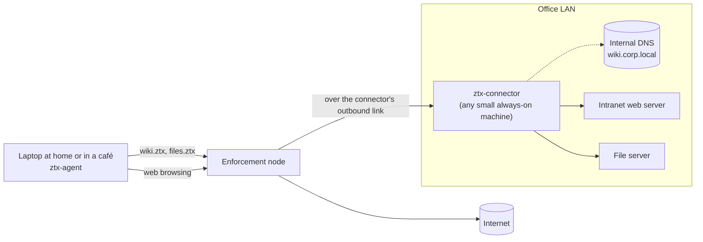

- **DNS.** The connector looks the target name up with *its own* resolver, so a target such as `wiki.corp.local` works if the connector machine uses the office DNS. Devices never need that DNS and are not given any: they use the short name from the agent config. Names are mapped by you in the agent's `apps` list; the product does not provide, filter or rewrite DNS (a DNS security service is in the not-built list).
- **The office web proxy.** The enforcement node dials websites directly. It cannot hand traffic on to a proxy you already run (no upstream chaining), so place the node where it has direct internet access, outside the office proxy, and have the agent use it. People in the office who do not run the agent keep using the old proxy and are not covered.
- **A PAC file or transparent proxy** is not offered (the spec lists them as agent alternatives, not built); browsers use the agent's local proxy port by setting it (or a managed setting from your device tool), or by using the workspace browser, which sets it itself.
- **Order of rollout that keeps people working:** one connector and one app; five pilot users; check the decision log for refusals nobody expected; add apps; only then remove the old route.

### What the product does with your data, in one picture

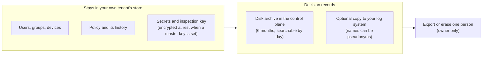

Known limits of all of this are under *Known limits that matter before real use* below.

## Try it on one machine

These steps use loopback ports and a throwaway data directory. You need an OIDC identity provider that supports the authorization-code flow with PKCE and can put a `groups` claim in the ID token (Entra ID, Google Workspace with groups, Okta). Register a **public** client with redirect URI `http://127.0.0.1/callback` (loopback with any port). Replace `ISSUER` and `CLIENT_ID` below.

```
make build && cd bin

# 1. control plane
echo 'choose-a-long-random-string' > boot.token
./ztx-cp --data cp-data --bootstrap-token-file boot.token &
# cp-data/ca.pem is the trust root every other component needs

# 2. create a tenant (prints an admin token; keep it)
CA=cp-data/ca.pem; BOOT=$(cat boot.token)
curl --cacert $CA -s -X POST https://localhost:8443/v1/tenants \
  -H "Authorization: Bearer $BOOT" -d '{"id":"acme","name":"Acme"}'
export TOK=<admin_token from above>

# 3. identity provider, one private app, safe-default policies
curl --cacert $CA -s -X PUT https://localhost:8443/v1/idp -H "Authorization: Bearer $TOK" \
  -d '{"issuer":"ISSUER","client_id":"CLIENT_ID","group_claim":"groups"}'
curl --cacert $CA -s -X POST https://localhost:8443/v1/segments -H "Authorization: Bearer $TOK" \
  -d '{"id":"wiki","group":"office","class":"standard","targets":[{"host":"127.0.0.1","ports":[8000]}]}'
curl --cacert $CA -s -X POST https://localhost:8443/v1/policies/safe-defaults -H "Authorization: Bearer $TOK"
# the safe defaults let the IdP group "all-staff" reach standard apps from devices
# with disk encryption and the firewall on; web categories malware, phishing and
# command-and-control are blocked

# 4. enforcement node
curl --cacert $CA -s -X POST https://localhost:8443/v1/ens/tokens -H "Authorization: Bearer $BOOT" \
  -d '{"names":["localhost","127.0.0.1"]}'          # -> {"token": "..."}
echo '{"malware":["example-bad.test"]}' > categories.json
ZTX_EN_TOKEN=<token> ./ztx-en --cp-ca $CA --categories categories.json &

# 5. connector (next to the app)
curl --cacert $CA -s -X POST https://localhost:8443/v1/connectors/tokens \
  -H "Authorization: Bearer $TOK" -d '{"group":"office"}'
ZTX_CONNECTOR_TOKEN=<token> ./ztx-connector --cp-ca $CA --en 127.0.0.1:9443 --en-name localhost &
python3 -m http.server 8000 --bind 127.0.0.1 &       # the "private app"

# 6. agent (on the user's device)
mkdir -p ~/.ztx-agent && cat > ~/.ztx-agent/config.json <<EOF
{"tenant":"acme","issuer":"ISSUER","client_id":"CLIENT_ID","enrol_url":"https://localhost:8444",
 "enrol_ca_pem":"$(sed ':a;N;$!ba;s/\n/\\n/g' $CA)",
 "en_addrs":["127.0.0.1:9443"],"proxy_addrs":["127.0.0.1:9444"],"en_name":"localhost",
 "apps":{"wiki.ztx":"wiki"}}
EOF
./ztx-agent enrol        # opens the browser to sign in
./ztx-agent run &
curl --socks5-hostname 127.0.0.1:1080 http://wiki.ztx:8000/   # reaches the private app
curl -x http://127.0.0.1:3129 http://example-bad.test/        # 403 block page
curl -s http://127.0.0.1:9100/status                           # agent status
curl --cacert $CA -s https://localhost:8443/v1/alerts -H "Authorization: Bearer $TOK"
```

If the device fails the posture check (no disk encryption detected, or no firewall detected), the private app is denied and the decision log at `en-data/decisions.jsonl` says why. On Windows the firewall probe is not implemented, so posture-protected apps are denied there.

Fast reaction to a suspected compromise: `POST /v1/users/{id}/restrict` puts the user in a product-side `restricted` group. The safe-default policies deny it first, so live sessions end within seconds without waiting for your identity provider. `POST /v1/users/{id}/unrestrict` lifts it. If you wrote your own policy, add a deny rule for the group `restricted`.

**Workspace browser (unmanaged devices): proof of concept, no data controls.** It is an isolated browser profile with a forced proxy and automatic locking. It does **not** restrict clipboard, downloads, uploads, printing, drag-and-drop or screenshots, and has no watermark: those need an in-browser extension that Chrome 146 will not load from the command line, and are deferred to a later version. The launcher prints this notice every time it starts.

Setup: enrol it with `ztx-agent --dir ~/.ztx-workspace enrol-workspace`, then run `ztx-agent --dir ~/.ztx-workspace workspace [https://start.page]`. It starts Chrome, Chromium or Edge in a fresh isolated profile (no sync, no extensions, no QUIC) that reaches everything through the agent's local proxies, and locks itself (closes the browser, erases the profile) if the device is revoked, falls below the baseline (disk encryption and firewall) or loses the control plane for more than 5 minutes. Mark an app `"class": "sensitive"` and the safe defaults allow it only from the workspace. Tested with real headless Chrome on Linux only. With inspection on, the workspace trusts the tenant's inspection key by a Chrome pin, in that browser only; a plain browser on the same proxy still shows certificate errors.

TLS inspection: `PUT /v1/inspection {"enabled": true, "exempt": ["bank.example"]}` decrypts HTTPS (except the exempt domains) so web rules can use `paths` and `methods`. Download the tenant's inspection certificate from `GET /v1/inspection/ca.pem` and install it on devices (system or browser trust store); until then inspected sites show certificate errors. Sites that refuse a replaced certificate go on the exempt list; the decision log records `inspection-handshake-failed` for them. It is off by default. No WebSockets or HTTP/2 through inspected tunnels.

Response DLP (needs inspection on): a web rule with `"dlp_response": ["credit-card"]` and the action `deny` blocks responses whose text contains those data types. It scans text up to 1 MiB, decompresses gzip, and does not scan binary content.

Developer tools (needs inspection on): `eval "$(ztx-agent dev-env)"` points curl, git, pip, npm, Python, Go, AWS CLI and others at the proxy and at the tenant's inspection certificate (with the public roots kept). Java tools, Docker's daemon and certificate-pinning tools need manual steps; the command lists them.

Data loss prevention (needs inspection on): a web rule can carry `"dlp": ["credit-card", "us-ssn", "iban", "aws-access-key", "private-key", "github-token"]` and block uploads whose body contains any of them. Only the data type is logged, never the data. It is pattern based and basic, scans bodies up to 1 MiB and does not open archives or documents.

Just-in-time access: give a rule the action `require_approval` (it must name its apps). The first attempt is blocked and opens a request (emailed to the alert recipients when SMTP is set). Approve it with `POST /v1/approvals/{id}/approve {"minutes": 60}` or in the console; access starts within seconds and ends on its own, or earlier with `POST /v1/approvals/{id}/end`.

Shadow AI and agent risk: `GET /v1/shadow-ai?days=7&sanctioned=ChatGPT,Claude` lists which well-known AI tools people (and agents) used through the proxy, unsanctioned first, with the limits in `notes`. `GET /v1/ai-agents/{name}/lint` warns when one agent can read private apps, read untrusted sites and send data to them, and says which leg to remove.

AI agents never exceed their operator: an agent can reach a private app only if the person it runs for can reach it under the private policy (and is enabled and not restricted). When the operator loses access the agent's live sessions close at the next re-evaluation. Agents created before this rule have no operator recorded; re-create them to apply it.

Read-only AI agent (needs inspection on): `GET /v1/ai-agents/{name}/readonly-pack?domains=api.crm.example&model=api.model.example` returns web rules that let that agent read the listed services, refuse writes (POST, PUT, PATCH, DELETE), allow the model provider, and refuse every other destination. Nothing is applied: put the rules in front of your web rules and save. Read the `warnings` in the answer: without inspection, or on exempt domains, writes are not seen.

Exact data match (needs inspection on): `PUT /v1/edm/customers` with `{"values": ["CUST-004711", ...]}` stores salted hashes of up to 10,000 values (each a single token of 4 to 64 letters, digits or `. _ @ + -`); the values themselves are not kept. A web rule with `"dlp": ["edm:customers"]` and action deny then blocks decrypted requests that contain one, and `dlp_response` does the same for responses. A short or guessable value can be guessed from its hash by whoever holds the hashes.

Where is it slow: the agent reports Wi-Fi signal and router speed (Linux), name-resolution time, and, if you set `"path_anchor": "host:443"` in its config, the time to a neutral site. The device's experience score then says whether the Wi-Fi, the office router, DNS, the internet provider or the path to the enforcement node is the likely cause. Without an anchor no device contacts any third party, and the provider cannot be told from the node. Set `"disable_path_probes": true` to turn the measurements off.

Removable media (Linux agents): add `"posture": {"removable_media": false}` to a rule to allow access only while no USB stick or SD card is mounted. It is a device-state check evaluated when the posture report arrives; it does not stop copying, see files, or work on macOS and Windows (where the value is unknown and the rule denies).

Documents you must not lose: `PUT /v1/edm/pricelist` with `{"documents": ["...pasted text..."]}` keeps only hashes of eight-word runs. A web rule with `"dlp": ["edm:pricelist"]` then blocks decrypted requests that repeat about ten words in a row from it. Text only; an edited copy or a short excerpt is not found.

Policy history: `GET /v1/policies/web/versions` lists the last 50 saved versions with who saved each; `GET /v1/policies/web/diff?from=3` says what changed since version 3 (rules added, removed, changed, default action); `POST /v1/policies/web/rollback` with `{"version": 3}` and `If-Match: <current>` saves version 3 again as a new version. Nothing is rewritten, and every rollback is in the audit log.

Certificate lifetime: `ztx-cp --device-cert-ttl 1h` sets how long a device certificate lives (default 12 hours, 30 seconds to 7 days). A shorter life means a revoked or disabled user loses access sooner, and agents renew a third of the lifetime before expiry (at most an hour).

Administrator roles: an owner creates administrators with `POST /v1/admins` (`{"name": "carol", "role": "helpdesk"}`; the token is shown once). Roles: `owner` (everything, and manages administrators), `admin` (everything else), `helpdesk` (reads, decision records, approving access, revoking a device, restricting a user), `auditor` (reads everything including the audit log and evidence, changes nothing), `viewer` (read-only dashboards and configuration, no logs). `GET /v1/admins` lists them, `DELETE /v1/admins/{name}` removes one and ends their token; the last owner cannot be removed.

Log streaming to your SIEM: `PUT /v1/siem` with `{"kind":"https","url":"https://siem.example.com/ingest","token":"Bearer abc"}` or `{"kind":"syslog","addr":"siem.example.com:6514","proto":"tls"}` streams decision records and admin audit events; `POST /v1/siem/test` sends a test event; `GET /v1/siem` shows how it is doing. Fields, transport and limits: [SIEM-SCHEMA.md](SIEM-SCHEMA.md).

Tenancy restriction (needs inspection on): `PUT /v1/tenancy` with `{"microsoft": {"allowed": ["contoso.com"], "context": "<your directory ID>"}, "google": {"allowed": ["contoso.com"]}, "slack": {"allowed": ["T01ABCDEF"]}}` makes the platform add each vendor's tenant-restriction header on decrypted sign-in traffic, so people cannot sign in to personal or foreign accounts from managed devices. The vendor enforces it. `GET /v1/tenancy` lists what stops it working. The header names and hosts have not been checked against the live services: see the limits in STATUS.md S25.

File type control (needs inspection on): a web rule with `"upload_file_types": ["executable", "archive"]` or `"download_file_types": ["executable", "disguised", "ext:.iso"]` and the action `deny` refuses those transfers. Kinds are `executable`, `script`, `archive`, `disk-image`, `office-macro`, `office-document`, `pdf`, `image`, `audio-video`, `disguised` (a program under a harmless name or type) and `ext:.abc`. Detection uses the name, the declared type and the file's first bytes, so renaming a program does not get it through; it does not look inside archives.

Decision history: the control plane keeps decision records on disk for six months (`ztx-cp --log-retention-days 183`). `GET /v1/decisions/history?from=2026-11-01&to=2026-11-07&user=alice&action=deny&limit=200` searches them, oldest first, and returns a `next_cursor` for the next page. Needs the helpdesk, auditor, admin or owner role. The enforcement node's own `decisions.jsonl` is not rotated by the product.

Privacy mode for logs: `PUT /v1/privacy` with `{"pseudonymise_users": true}` replaces people's names with stable pseudonyms (`u-0123456789ab`) in the decision records the platform stores, streams to your SIEM and shows. An owner can look a pseudonym up with `GET /v1/privacy/reveal?pseudonym=...` (audited). It does not cover the admin audit log, alert or e-mail text, or what was stored before it was turned on; see STATUS.md S28.

Block pages say why: every refusal and warning page has a plain-language reason (or the text you wrote on the rule) and a reference. Give the reference to the decision search to find the record: `GET /v1/decisions/history?ref=0123456789ab`.

Provisioning from your identity provider (SCIM): an owner runs `PUT /v1/scim` with `{"enabled": true, "require_provisioned": true}` and `POST /v1/scim/token` (the token is shown once). In Entra ID, Okta or Google Workspace, set the SCIM base URL to `https://<admin address>/scim/v2` and the token as the bearer token. People are matched to their sign-in by e-mail; their groups then come from SCIM, a deactivated or removed person loses access at once, and with `require_provisioned` nobody else can enrol. Tested with this project's own client, not yet with a real provider: see STATUS.md S30.

When a node is cut off: `PUT /v1/failure-mode` with `{"on_stale": "deny" | "cached", "on_log_failure": "deny" | "allow"}` decides, per organisation, whether new private-app sessions and web requests are refused (the default) or go on when an enforcement node has not heard from the control plane for its window (`--stale-after`, 15 minutes by default), or cannot write its log. Open sessions are never cut. Read the trade-off in the answer of `GET /v1/failure-mode` before choosing `cached` or `allow`.

Cloud app control: a web rule such as `{"action": "deny", "match": {"cloud_apps": ["dropbox"], "cloud_actions": ["upload", "share"]}}` refuses uploads and shares to an app while leaving the rest of it alone (needs inspection on for actions). `GET /v1/cloud-apps` lists the apps; add or correct one with `PUT /v1/cloud-apps/{id}`. The built-in apps are hand-made and have not been checked against the live services: see STATUS.md S32.

Exemptions from TLS inspection: besides your own `exempt` list, inspection leaves alone the applications in a built-in list that break when intercepted, and sites in the categories `banking` and `health` (change with `"exempt_categories"`, switch the built-in list off with `"managed_exemptions": false`). The category part needs a category list on the enforcement nodes (`--categories`): the platform ships none for banking or health. See `GET /v1/inspection` and STATUS.md S33.

Vendor support access: an owner runs `POST /v1/support-access` with `{"reason": "ticket 4711", "hours": 4}` to give the vendor a temporary account (auditor by default). It ends by itself, can be ended at once with `DELETE /v1/admins/{name}`, and `GET /v1/admins` shows its reason, end time and when it was last used; what it does is in the audit log under its own name. `POST /v1/admins` also takes `expires_in_hours` for any other temporary administrator.

Safe defaults: `POST /v1/policies/safe-defaults` applies the shipped policy pack (restricted users, known-bad and risky sites, posture for apps, the workspace browser for sensitive apps, no uploads to anonymous sharing services, no programs sent out, no disguised programs downloaded). The last three need TLS inspection: add `{"inspection": true}` once your devices trust the inspection CA, and `"block_uploads_to": ["dropbox"]` to refuse uploads to more services. Applying it replaces the web and private policies; the earlier versions stay in the history.

API description: `GET /v1/openapi.json` (or the committed `API.openapi.json`) is an OpenAPI 3.0.3 description of every administrator route, with the permission and roles each needs. It is generated from the routes as registered; request and response fields are not described, and there is no Terraform provider.

Encryption at rest: make a key with `ztx-cp gen-master-key`, keep it **somewhere other than the server's disk** (a password manager or secrets manager, plus a second copy: without it the data cannot be read), and start with `ztx-cp -master-key-file /run/secrets/ztx-master-key ...` (or the `ZTX_MASTER_KEY` variable). The CA key, the signing key and the store (tenant secrets, inspection keys) are then encrypted on disk, and a plain installation is encrypted at its first start. A backup of encrypted data is encrypted, and `ztx-cp restore` needs `-master-key-file`. This protects a stolen disk or backup; it does not protect against someone who is root on the running server, it does not wipe copies of the old clear files (rotate secrets that were in clear), and the audit log and decision records are not encrypted.

IPv6 and network rules: a rule can name where the user connects from (`"network": {"src_cidrs": ["203.0.113.0/24", "2001:db8:1::/48"]}`), with IPv4 and IPv6 prefixes in one list; the node judges the address **it sees**, so use it for a fixed office address, not for people (behind a NAT every user shares one address and home IPv6 addresses change). Before this version such a rule never matched, so check any rule that has one. Nodes can listen on IPv6 (`-listen [::]:9443`) and a connector can reach an app at an IPv6 address; apps are always addressed by name, so users never type one. The simulator takes `src_ip`. Not tested: an IPv6-only network (NAT64/DNS64) and the real programs end to end over IPv6.

Accessibility: the console and the pages shown when someone is stopped have been checked with an automated tool (axe-core) in the light and the dark setting, by keyboard and at a phone width, and the contrast of every colour is tested. **This is not a claim of WCAG 2.1 AA conformance**: it has not been tried with a screen reader or by a person who uses assistive tools (`USABILITY-RUNBOOK.md`, A11Y-001), only Chrome was used, and **everything is in English** (no translation yet). The browser checks are in `test/a11y`.

Upgrades: a component may be at most one minor version older than the control plane and never newer, so upgrade in this order: control plane, enforcement nodes, connectors, agents, and you can stop between steps. `GET /v1/versions` (or the **Versions** screen in the advanced console) shows who runs what and warns about anything outside that window. Nothing updates itself: you replace each program by hand with a build from `ztx-release` after checking its signature (RELEASE.md), and back up the control plane first (`ztx-cp backup`). The rule is advice that this list checks; the wire protocol does not enforce it, only `-min-agent-version` stops an old agent.

Lockout: an address that fails to sign in 10 times in a minute (a wrong admin token, bootstrap token or enrolment token) is refused with 429 for 5 minutes, then 10, up to an hour, and the control plane logs a `SECURITY:` line. Even the right token is refused from that address until it ends. **If your office or a proxy shares one address, list it with `-auth-limit-exempt 203.0.113.0/24`** (otherwise one broken script locks everyone out for five minutes); `-auth-fail-limit 0` turns it off. `GET /v1/keys` says how many lockouts there were in the last day.

If every owner token is lost: on the server, stop the control plane and run `ztx-cp reset-owner -data cp-data -tenant acme` (add `-master-key-file` if the data is encrypted; `-list` shows the tenant and administrator names first). It prints a new owner token once and invalidates the old one. It is recorded in the audit log as made at the server, and the next weekly summary lists it as a possible break-in unless it was you. It does not need, and does not give, any remote way in.

If a key leaked: `GET /v1/keys` (owner, admin or auditor) lists the platform's keys, how old each is, how to replace it, and warns about old tokens, a missing master key and a CA near its end. Replace what leaked, in this order:
1. **An administrator's token:** `POST /v1/admins/{name}/rotate` (an owner), or `POST /v1/me/rotate` for your own. The old token stops at once. If the person should not have access at all, remove the account instead.
2. **The SCIM token:** `POST /v1/scim/token`; the old one stops at once. Change it in your identity provider.
3. **Secrets stored for credential injection:** change them at the service they belong to, then store the new value; replacing them here does not help if the service still accepts the old one.
4. **The TLS inspection CA:** turn inspection off, `POST /v1/inspection/rotate`, install the new certificate from `GET /v1/inspection/ca.pem` on every device and remove the old one (the fingerprints are in the answer), then turn inspection on. Devices that still hold the old certificate keep trusting anything the leaked key signs until you remove it.
5. **The master key:** stop the control plane and run `ztx-cp rekey -data cp-data -master-key-file OLD -new-master-key-file NEW`. Backups made before still need the old key.
6. **The device CA key or the policy signing key (the control plane's data directory was stolen, or its encryption key was lost together with the data):** there is no overlap mechanism. Stop the control plane, take a backup, move `ca.key`, `ca.pem` and `policy.key` out of the data directory, and start it: it makes a new CA and signing key. Nothing connects until every enforcement node, connector and agent is enrolled again with the new CA (new one-time tokens, the new `ca.pem`); during that time access fails closed. Rotate everything in steps 1 to 5 as well. **This procedure was written from how the parts work and has not been rehearsed: try it once on a test installation before you need it.**

Backup and restore: `ztx-cp backup -data cp-data -file /safe/place/cp.tgz` copies the control plane's whole data directory (the CA and signing keys, the store, the audit chain and the decision archive) into one file; it can run while the control plane is up, so put it in cron or a systemd timer. `ztx-cp verify-backup -file cp.tgz` checks it. To recover, stop the control plane and run `ztx-cp restore -data cp-data -file cp.tgz` (an existing directory is refused unless you add `-force`, which moves it aside, never deletes it). Devices keep working because the CA key comes back with the data. **Three things to know:** the file holds your CA private keys and secrets **in clear unless you use a master key** (then it is encrypted), so keep it as you would the keys; anything changed after the backup is lost, **including revocations: after a restore, check that revoked devices and disabled people are still revoked and disabled**; and enforcement nodes and connectors keep their own identity files and are not in this backup.

Person left: `POST /v1/users/{id}/offboard` (or the **Person left** button on the People screen) disables the account, revokes their devices, ends their temporary access and refuses their waiting requests in one step, and answers with a checklist. It lists what it could not do: it cannot end their account at your identity provider or other services, and cannot find AI agents or shared secrets they set up. Do those by hand.

Data about a person: an owner can ask what the platform holds about someone with `GET /v1/privacy/subject?user=alice@example.com` and erase it with `DELETE /v1/privacy/subject?user=alice@example.com&confirm=alice@example.com`. Erasure removes the person from the user, SCIM, device, grant, request, alert, health and decision-record stores (devices are revoked, not deleted, so their certificates stay dead). The admin audit log, the nodes' own log files, streamed copies and backups are not touched; the answer says so. See STATUS.md S38.

Credential injection (needs inspection on): store a credential with `PUT /v1/secrets/{name}` (`host`, `header`, `value`), then give a web rule `"inject": "name"` (action allow, domains inside the secret's host). The enforcement node adds the header to the decrypted request, replacing the agent's own, so an AI agent can call the API without ever holding the key. Values are write-only: `GET /v1/secrets` lists names, hosts and headers only, and the value is kept out of the audit log, decision log, captures and responses (it is scrubbed if the API echoes it back). The value is stored in clear in the control-plane store file and on enforcement nodes, as the inspection key is.

Traffic capture (needs inspection on): a web rule with `"capture": true` (and conditions that narrow it) keeps the decrypted exchanges it decides for one hour, with credentials redacted and bodies cut at 64 KiB. Admins read them with `GET /v1/captures` and `GET /v1/captures/{id}`; every read is audited, and `DELETE /v1/captures` removes them. They are never written to the enforcement node's disk. Treat the admin role as able to read web sessions.

Incidents: `GET /v1/incidents` (and the Incidents tab) puts together what happened to one person in the last 24 hours (a failing device, repeated blocks, blocked transfers of sensitive data) into one sentence with a severity and what to do.

On-site enforcement node (private service edge): run `ztx-en` on the office network beside the connector, enrol it with its own token (`POST /v1/ens/tokens`), and list it first in the office agents' `en_addrs`. Office users then reach local apps through it without leaving the site, and it keeps enforcing its cached policy if the internet or the control plane is down. It is customer-run; list a second node after it for failover.

Redundancy: run two or more enforcement nodes, list them all in the connector's `--en` (comma separated) and in each agent's `en_addrs`. If a node dies, access continues through the others within seconds.

Device health and experience: `GET /v1/health` also gives each device an experience score (0 to 100) built from how long the agent took to connect and to open apps, with a one-sentence cause: device, network or app side. It shows each device's CPU load, memory and disk use as last reported by the agent (Linux agents only) with plain-language findings such as a nearly full disk.

AI agents: `POST /v1/ai-agents {"name":"code-helper","operator":"alice","apps":["erp"],"minutes":120}` creates a named identity run by a person, allowed only those apps for that long, and returns a one-time token for `ztx-agent enrol-service`. Add a `require_approval` rule for the group `ai-agent` (naming the apps) or the agent gets nothing. `DELETE /v1/ai-agents/{name}` ends it at once.

Risk: `GET /v1/risk` lists users with a 0 to 100 score and the reasons. A rule can use it with `"max_risk": 49` or `"min_risk": 70`. The safe defaults do not, so nothing is blocked on risk until you add such a rule.

Console: open `https://localhost:8443/` (the admin listener) and sign in with the admin token. It opens in a simple mode with three screens (alerts, users, apps, with who can reach each app in words); "Show all screens" adds access decisions, incidents, approvals, inspection, a policy simulator, reports and an investigation page. Each role sees only the screens it may use. It was walked through by hand in Chrome against sample data, but not on phones, other browsers or with assistive technology: report anything odd. To look at it without deploying anything, run `go run ./cmd/ztx-demo` (lab only: plain HTTP, loopback only, sample data in memory; it prints a token).

Screenshots of the console in its dark theme (it follows the browser's light or dark setting). They were taken from the lab demo (`ztx-demo`), so the names, alerts and numbers are sample data, not a real organisation.

**Simple mode** (what a small business sees first: alerts, users, apps)

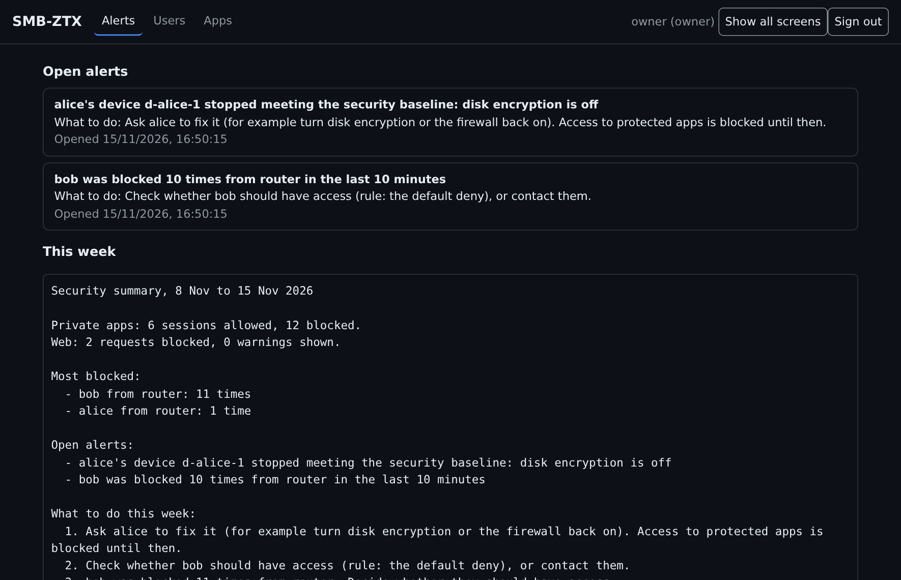
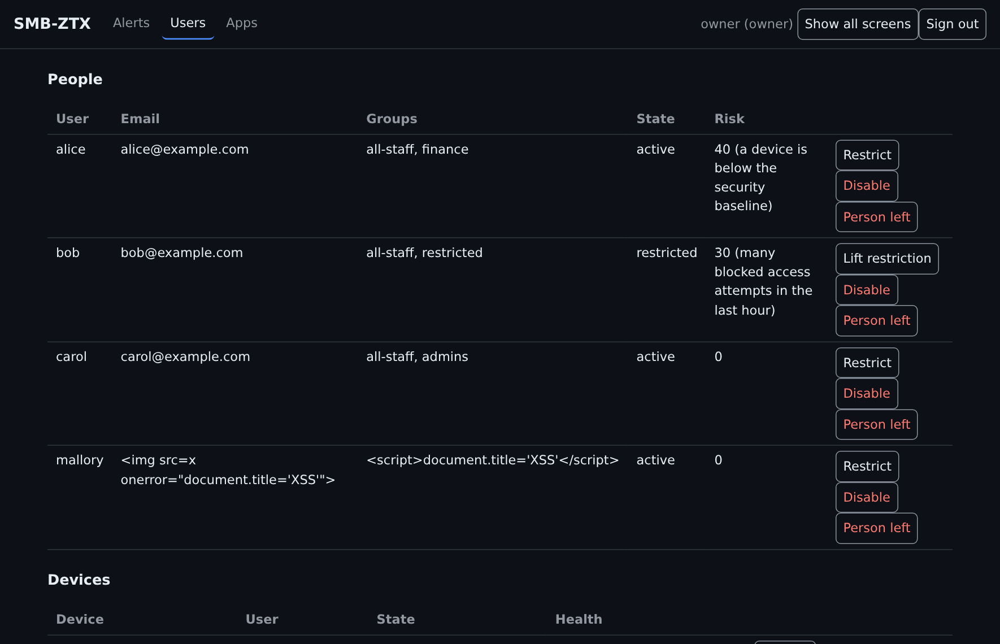
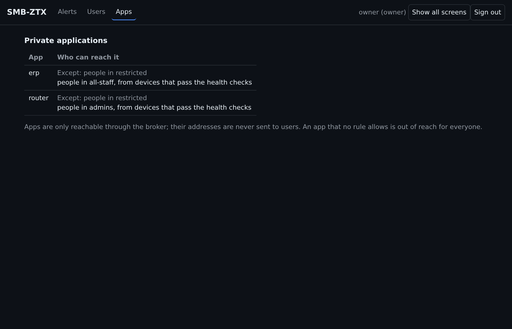

**Advanced mode** ("Show all screens")

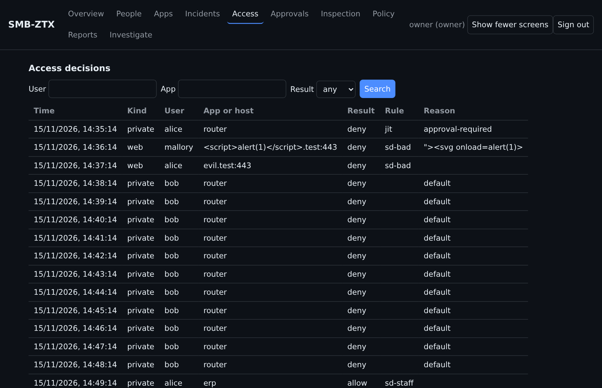
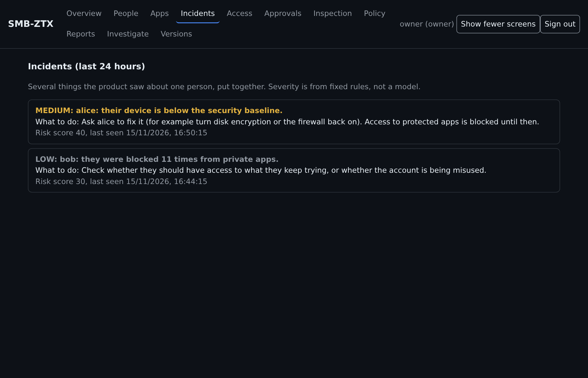
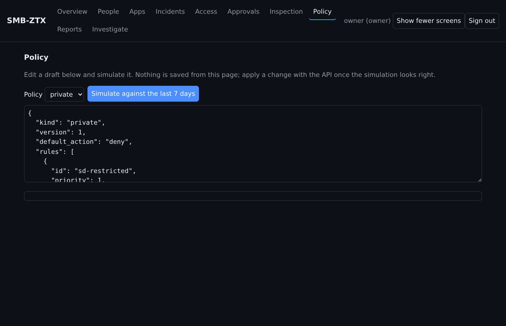


Alert emails: start `ztx-cp` with `--smtp-addr host:port --smtp-from alerts@yourdomain` (password in `ZTX_SMTP_PASSWORD`), then `PUT /v1/alert-settings` with `{"emails":["owner@yourdomain"]}`.

Weekly digest: `GET /v1/digest?days=7&format=text` returns the plain-language summary; with SMTP configured it is emailed to the same recipients every Monday 08:00 UTC. Search recent access decisions with `GET /v1/decisions?user=&app=&action=&since=`.

Try a rule change safely: `POST /v1/policies/private/simulate` with `{"policy": {...draft...}, "days": 7}` replays recent private-access decisions against the draft and lists who would be newly allowed or blocked. Nothing is stored.

Why was someone blocked? `GET /v1/investigate?user=alice` gives a plain-language timeline and the likely fix. `GET /v1/suggestions` proposes rules for repeated blocks (and flags unhealthy devices instead of widening access). Suggestions are drafts: simulate them first.

Insurance questionnaire evidence: `GET /v1/evidence?format=text`. It reports only what this product can show and marks everything else (MFA, EDR, backups) as not evidenced.

Secrets are read from files or environment variables and never from command-line arguments.

## Known limits that matter before real use

- TLS inspection is basic (see above) and off by default; there is no DLP or sandbox. With inspection off, web policy sees host names only.
- Posture is self-reported by the agent and can be forged by malware on the device.
- Certificates for connectors and enforcement nodes last 7 days and have no automatic renewal.
- Connector and enforcement-node state sync is a poll, not a push.
- Patent review of the connector stitching approach is needed before any commercial use (REQUIREMENTS.md section 15).
